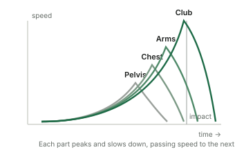

> [!key] Key points
> - Good swings speed up **from the ground up**: pelvis, then chest, then arms, then club.
> - Each segment **speeds up and then slows down**, passing its energy to the next.
> - Players use the **ground**, pushing sideways, rotating and pushing up, to create that speed.
> - Many amateurs reverse the order: the **arms and shoulders go first**, and speed leaks away.

## The kinematic sequence



Biomechanics research using motion capture has shown that efficient swings follow a consistent order in the downswing:

1. **Pelvis** peaks first
2. **Thorax** (chest) next
3. **Arms**
4. **Club** last, right at impact

Each segment peaks and then **decelerates**. That slowing down is important: like cracking a whip, when the handle slows, the tip speeds up. A pelvis that keeps spinning flat out actually robs the arms and club of speed.

```figure
type: sequence
poses: top, downswing, impact, release
pressure: true
caption: The lower body leads. Pressure moves to the lead side while the arms are still coming down.
```

## Using the ground
Force plates show good players push against the ground in three ways:

| Force | Direction | What it does |
| --- | --- | --- |
| **Horizontal (shift)** | Towards the target | Moves pressure to the lead side early in the downswing |
| **Rotational (torque)** | Twisting the feet against the ground | Powers the rotation of the pelvis |
| **Vertical** | Pushing up, then "posting" up through impact | Adds speed; many long hitters' heels leave the ground |

You don't need to think about these directly. Drills like the [[weight-transfer|step drill]] and speed training develop them naturally.

## Common amateur pattern
- **Arms and shoulders start the downswing** (from the top), so the club goes over the top.
- **Lower body stalls** or slides without rotating.
- **Club peaks too early** ("casting"), and is slowing down at impact.

The fix is almost always a better **transition**: pressure and pelvis first, arms dropping (see [[the-downswing]]).

> [!tip] Feel vs real
> Most golfers with a good sequence *feel* as though the arms are lazy and the club arrives late. If your swing feels arm-driven and quick from the top, it probably is.

> [!drill] Pump and go
> From the top, start down with the lower body and let the arms drop halfway, then return to the top. Repeat twice, then swing through on the third. It trains the ground-up order at slow speed.

> [!note] Measuring it
> Some golf studios use 3D motion capture or wearable sensors to measure your sequence. It isn't necessary for most golfers, but it can be eye-opening if you're stuck.
