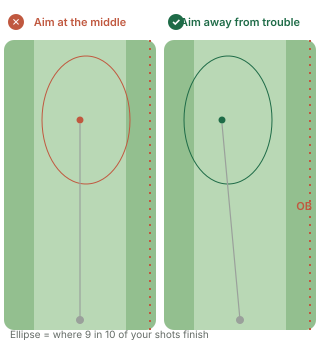

> [!key] Key points
> - Your shots land in an **oval pattern**, not on a single spot.
> - The pattern gets **bigger** with longer clubs and higher handicaps.
> - Aim so the **whole oval** avoids the worst trouble, even if that means aiming away from the middle.
> - This is how modern strategy systems (and many tour players) choose targets.

## Your shot pattern

Hit 20 balls with the same club at the same target and they'll land in an **oval**, longer than it is wide for irons, and wider with the driver. Roughly:

| Club | Typical width of the pattern (club golfer) |
| --- | --- |
| Driver | 50–70+ yards |
| Mid-iron | 30–40 yards |
| Wedge | 15–25 yards |

*Rough guides only. Measure your own on a launch monitor or by tracking shots.*

## Aiming with your pattern
1. **Picture your oval** around your target.
2. **Check what's inside it**: water, out of bounds, bunkers.
3. **Shift the aim** until the worst trouble is outside the oval, or at its very edge.
4. **Commit** to that target. Don't "half-aim" back towards the middle.

On a hole with out of bounds right, aiming down the left edge often puts **more** of your shots in the fairway *and* almost none out of bounds.

## Strategy systems
Methods like **DECADE**, created by golf strategist Scott Fawcett, are built on this idea: use statistics about where shots finish to choose targets that minimise big numbers. You don't need a formal system, but the principle — **aim with your pattern, avoid the big number** — is the foundation of good course management.

> [!mistake] Aiming for your best shot
> If your target only works when you hit it perfectly, half your shots will be in trouble. Aim for the shot you'll hit *on average*.

> [!tip] Smaller targets, bigger margins
> Aim at a *specific* point (so your pattern centres where you want it), but choose that point with *big margins* from trouble.

> [!drill] Map your pattern
> On a simulator or launch monitor, hit 20 shots with your driver and a 7-iron. Note the left-right spread that contains 18 of 20 shots. That's your working pattern. Write it next to your yardage chart and use it when choosing targets.
