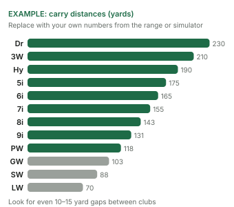

> [!key] Key points
> - Know how far each club **carries** in the air, not just how far it goes in total.
> - Use your **average**, not your best.
> - Aim for **even gaps** (about 10–15 yards) between clubs.
> - A launch monitor or simulator is the fastest way to get honest numbers.

## Carry vs total
- **Carry:** the distance the ball flies in the air.
- **Total:** carry plus roll.

For approach shots, **carry** is what matters: it decides whether you clear the bunker or land on the green. Roll changes from day to day with firmness and slope. With the driver, total distance matters more, because it decides where you'll play your next shot from.

## Average, not best
Your best 7-iron might go 165. If your typical one goes 152, then 152 is your 7-iron. Plan with the shot you hit most often, and you'll stop coming up short.

## Building your chart

1. **Warm up** properly first.
2. Hit **10 solid shots** with each club with a normal swing. Ignore obvious mishits.
3. Record the **average carry** (and total, if you can).
4. On a simulator or launch monitor, read the numbers directly. On a range, hit to flags with known distances. Many range balls fly shorter than normal balls, so check against real-course yardages.
5. For wedges, also record your **three partial swings** (see [[pitching-basics]]).
6. Put the chart in your phone or a small card in your bag. Caddie will hold it in a later version.

## Gapping
Look at the gaps between clubs.
- **Even gaps (10–15 yards):** good.
- **Two clubs that go the same distance:** one is wasted. Swap it for a club that fills a gap.
- **A big gap (25+ yards):** often between pitching wedge and sand wedge. Add a gap wedge (see [[wedges-lofts-and-bounce]]).

> [!mistake] Using tour-player distances
> Golf media is full of tour players hitting 9-irons 165 yards. Your numbers are your numbers. Choosing clubs based on what you "should" hit is the fastest way to come up short.

> [!tip] Re-check every season
> Distances change with fitness, swing changes, new clubs and the weather. Rebuild the chart a couple of times a year.

> [!drill] Simulator mapping session
> Devote one simulator session entirely to mapping your distances. Five balls per club, write down the median carry. It's not exciting, but it'll save more shots than any swing tip.
