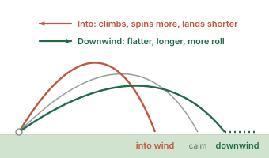

> [!key] Key points
> - Start with the **actual yardage**, then adjust it into a **"plays like"** number.
> - **Into the wind hurts more than downwind helps.**
> - **Uphill plays longer, downhill shorter**: roughly a yard for every yard (about 1 metre) of height difference.
> - **Cold air and a cold ball** fly shorter.

## The process
1. Get the **yardage** to your target (GPS, rangefinder, sprinkler heads).
2. Adjust for **wind**.
3. Adjust for **elevation**.
4. Adjust for **temperature** and **lie**.
5. Pick the club for the final number, and commit.

## Wind

| Wind | Rough adjustment |
| --- | --- |
| Into (headwind) | A light breeze: about **1 club more**. A strong wind: **2–3 clubs** more |
| Downwind (tailwind) | About **half the effect** of a headwind. A light breeze = ½ club less |
| Left-to-right / right-to-left | Aim into the wind. The ball drifts more the longer it's in the air |

Into the wind, the ball climbs and spins more, so mishits get punished more. **Swing smoother, not harder.** "When it's breezy, swing easy." More in [[playing-in-wind]].

## Elevation
- **Uphill:** plays **longer**. Add roughly a yard for every yard (metre) the green is above you.
- **Downhill:** plays **shorter** by about the same amount.
- Many GPS apps and rangefinders show a "plays like" slope number. It's great for practice rounds, but slope features aren't allowed in most competitions unless the club permits them.

## Temperature and air
- A cold morning can cost a few yards per club compared with a hot afternoon. A cold ball also flies shorter, so keep a spare one in your pocket in winter.
- Humid air is actually slightly *less* dense than dry air, so the effect is small. Don't worry about humidity.
- Altitude makes a big difference (the ball flies further in thin air), but most Australian courses are close to sea level.

## Lie
- **Rough:** may fly further (a flyer) or come out dead, depending on how the ball sits. See [[playing-from-the-rough]].
- **Ball above or below your feet, or on a slope:** see [[uphill-lie]] and the other slope lessons.

> [!mistake] Adjusting for everything twice
> "It's into the wind, so I'll take more club *and* swing harder." Choose the club for the conditions, then make your normal, smooth swing.

> [!drill] Plays-like practice
> On your next round, say the "plays like" number out loud before every approach shot, with your reasons. Afterwards, note whether you were short or long. You'll soon learn how much the conditions at your course really matter.
