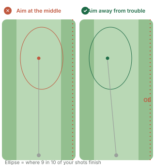

> [!key] Key points
> - Play the course **with the shots you actually have**, not the ones you hope to hit.
> - Set a **personal par** for each hole based on your handicap.
> - Decide the plan for the **hard holes before the round**, not on the tee.
> - The goal is to **avoid big numbers**. Doubles and triples wreck rounds far more than missed birdies.

## Know your game
Before you plan anything, be honest about:
- **Your typical miss** with the driver and irons (left, right, short?)
- **Your reliable distances** for each club (see [[knowing-your-distances]])
- **Your strengths:** is it wedges? Putting? A dependable 3-wood?
- **What costs you shots:** penalty drops, three-putts, chunked chips?

Your plan should steer you towards your strengths and away from your weaknesses.

## Personal par
If your handicap is 18, bogey on every hole *is* your par. Mark your "personal par" on the scorecard before the round:
- Handicap 18: par + 1 on every hole
- Handicap 9: par + 1 on the nine hardest holes (stroke index 1–9)
- Handicap 27: par + 1 everywhere, and par + 2 on the nine hardest

Then a bogey on a hard hole feels like what it is, a par, and you stop forcing heroic shots to make up for nothing.

## Plan the hard holes
Look at the course planner or the course's website and, for each hole that worries you, decide in advance:
1. **Club off the tee:** driver, or something that keeps the trouble out of play?
2. **Target line:** which side gives the best angle in, and which side has the trouble?
3. **Lay-up distance** on par 5s and long par 4s: to your favourite wedge yardage.
4. **Where not to miss** on the approach (see [[where-to-miss]]).

Write it on a small card or in your phone notes. On the day, the decision's already made; you just commit and swing.

> [!tip] Bogey isn't a disaster
> Most big numbers come from trying to rescue a bogey with a risky shot. When you're in trouble, ask: what's the shot that guarantees no worse than a bogey (or double)? Then hit that.

> [!mistake] Planning for your best shot
> If a plan only works when you hit your best drive, it's a bad plan. Plan for an average shot and you'll be ready for whatever happens.

> [!drill] Pre-round homework
> Before your next round, write a one-line plan for each hole: tee club, target, and where to miss. Afterwards, note which holes went to plan and which didn't. Adjust the plan for next time, not your swing.
