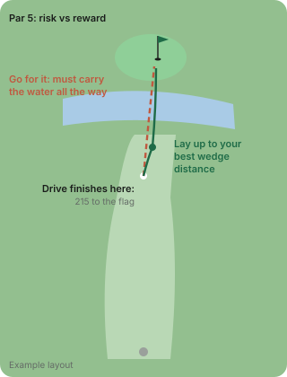

> [!key] Key points
> - **Par 3s:** club for the **middle of the green**, and always tee the ball up.
> - **Par 4s:** the tee shot sets up everything. **Position beats distance** on tight holes.
> - **Par 5s:** your best scoring chance. Plan it backwards from a **comfortable third shot**.

## Par 3s
- **Always use a tee**, even with an iron. A perfect lie every time. Tee it low, just above the grass.
- **Club for the middle** of the green, not the flag. Check where the front, middle and back are.
- **Take enough club.** Most par-3 misses are short. If you're between clubs, go up (see [[between-clubs]]).
- **Tee up on the side of the trouble** and aim away from it (see [[finding-fairways]]).

## Par 4s
- Look at where the **fairway is widest** and where the trouble is. That decides the tee club.
- **Short par 4s:** tempting to drive near the green, but often the hole is designed to punish that. A lay-up to a full-wedge distance is usually the better play.
- **Long par 4s:** for many golfers these play as a "par 4.5". Bogey is fine. Two solid shots and a chip or pitch beats forcing a long iron at a guarded green.
- **Angle matters.** Sometimes the side of the fairway away from the flag gives a better line into the green.

## Par 5s
Plan **backwards**:
1. Where do I want to hit my **third shot** from? Usually your favourite full-wedge yardage.
2. So where does my **second shot** need to finish?
3. So which **tee shot** sets that up best?

**Going for it in two** only makes sense when the miss is safe and you can carry the trouble comfortably (see [[risk-and-reward]]). If not, the three-shot plan gives you plenty of birdie chances with far less risk.

| Hole | Typical club-golfer goal |
| --- | --- |
| Par 3 | Green in one, or a simple chip. Avoid big misses |
| Short par 4 | Position off the tee, then a wedge |
| Long par 4 | Avoid trouble, accept bogey as fine |
| Par 5 | Three solid shots, two putts. Birdie chances come naturally |

> [!mistake] Driver on every par 4 and 5
> On some holes the driver brings out-of-bounds or water into play for little gain. Ask what you're trying to set up, then pick the club that does it most reliably.

> [!drill] Score by hole type
> Track your average score on par 3s, 4s and 5s over five rounds. Most golfers find one type costs them the most. That's where to focus your strategy and practice.
