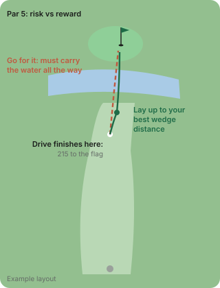

> [!key] Key points
> - Compare the **best realistic result** with the **worst realistic result** of each option.
> - Attack when the **downside is small**. Play safe when it's big (water, out of bounds).
> - Be honest about **how often** you'd pull the shot off.
> - Laying up to a **full wedge** distance usually beats a long, awkward pitch.

## The question to ask

For each option, picture ten attempts and ask:
- **How many come off?**
- **What happens to the others?**

**Example (the diagram above):** a par 5 with 215 yards left, all carry over water.

| Option | 10 attempts (a mid-handicapper) | Likely average |
| --- | --- | --- |
| Go for it with a 3-wood | 3 on or near the green, 3 in the water (+1 penalty), 4 short and wide | Around a bogey |
| Lay up to 90 yards, then wedge | Nearly always on the green in 3 | Around a par |

The lay-up has fewer birdie chances but far fewer disasters. Over a season that's a lot of shots.

## When attacking makes sense
- **The miss is safe:** rough or a flat bunker, not water or out of bounds.
- **You have a reliable shot** for the distance: one you hit well most of the time.
- **The match situation calls for it:** in match play, if your opponent is safely on in two, the safe play won't win the hole.
- **The lie is good.** From rough or a bad lie, the odds drop sharply.

## When to play safe
- Water, out of bounds or deep trouble on the **likely miss**.
- A long carry you only make with your best swing.
- A **bad lie** or awkward stance.
- You're **protecting a good score** late in the round.

> [!tip] Lay up to your favourite yardage
> Don't just hit it "as close as possible". If your best wedge is from 90 yards, lay up to 90, not 40. A full wedge is far more reliable than a half-shot pitch.

> [!mistake] The hero shot after a bad shot
> After a poor drive, the urge is to make up for it with a heroic second. That's when doubles and triples happen. Take your medicine (see [[recovery-shots]]).

> [!drill] Two-ball strategy test
> On a quiet hole in a practice round, play two balls from the same spot: one aggressive, one conservative. Finish both. Record the scores over several rounds. Your own results are the best guide to which option suits your game.
