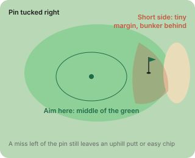

> [!key] Key points
> - You'll miss most greens and many fairways, so **plan the miss**.
> - **Good misses:** the fat side of the green, short of an uphill green, the side away from hazards.
> - **Bad misses:** short-sided, in water or out of bounds, long over a green sloping away from you.
> - Ask **"where's the big number?"** and aim away from it.

## Every hole has a safe side

Before every approach, look for:
- **Hazards:** water, out of bounds, deep bunkers. Never miss on that side.
- **The short side:** if the pin is near an edge, a miss there leaves little green to work with.
- **Slope:** is the green tilted? Missing on the low side often leaves an uphill chip.
- **Long vs short:** many greens slope back to front, so short is often better than long.

Then pick a target that keeps your typical miss on the safe side.

## Using your miss
If your normal shot shape is a fade:
- Pin on the **left**, trouble left: aim at the middle and let it fade away from the trouble.
- Pin on the **right**, trouble right: aim further left than feels natural. A fade that doesn't come back still finishes safely.

The same logic works in reverse for a draw.

## Good and bad misses around greens

| Miss | Usually… |
| --- | --- |
| Pin-high on the fat side | An easy chip or putt |
| Short of the green, uphill | A simple chip into the slope |
| Long, green sloping away | A fast downhill chip; often a bogey |
| Short-sided in a bunker | A hard shot; bogey or worse is common |
| Water or out of bounds | At least two shots lost |

> [!mistake] Aiming at the flag when the flag is near trouble
> The closer the flag is to trouble, the further from it you should aim. Middle-of-green golf turns doubles into bogeys and bogeys into pars.

> [!drill] Call your miss
> On the course, before each approach, say out loud where you're happy to miss ("anywhere left is fine"). Afterwards, note whether misses went to the safe side. It's a simple habit that changes how you aim.
