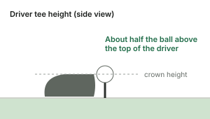

> [!key] Key points
> - **Tee it high:** about half the ball above the top of the driver.
> - **Ball forward:** in line with the inside of your lead heel.
> - **Wider stance** and a little more **weight on your trail side**.
> - **Tilt your spine away** from the target so you can hit slightly **up** on the ball.

## Why the driver is different

With irons you hit **down** on the ball. The driver is the opposite. The ball sits on a tee, and you want to catch it just after the bottom of the swing, travelling slightly **upwards**. That launches it higher with less backspin, which is the recipe for distance. Every part of the driver setup is designed to make that upward strike easy.

## Tee height

With modern deep-faced drivers, about **half the ball should sit above the crown** (the top edge) when the club rests behind it. Tee too low and you'll hit down on it. Tee too high and you risk sliding under it and skying it.

## The setup, step by step

1. **Ball position:** in line with the inside of your lead heel. It's the most forward ball position in the bag (see [[ball-position]]).
2. **Stance:** a little wider than shoulder-width, for a stable base.
3. **Spine tilt:** let your trail shoulder sit noticeably lower than your lead shoulder, and your head stay behind the ball. Your upper body tilts slightly away from the target.
4. **Weight:** about 60% on your trail side at address.
5. **Hands:** level with the ball or very slightly behind it. **No forward shaft lean** like you'd have with an iron.
6. **Clubface:** sole it lightly behind the ball, aimed at your target. Many players hover it just off the ground to keep the takeaway smooth.

> [!mistake] Setting up like an iron
> Ball in the middle, hands forward, weight on the lead side: that makes you hit down on the driver. The usual results are low, spinning shots, slices and "sky balls" off the top of the face. Set up for an upward strike.

> [!tip] Quick check
> Hold your driver across the front of your shoulders at address. It should tilt up towards the target. If it's level, add more tilt.

> [!drill] Tee-height test
> On the range or simulator, hit five drives each with the tee low, medium (half the ball above the crown) and high. Note where on the face you strike it (foot-powder spray on the face shows this) and which height gives you the best flight. Then always tee it to that height.

Next: [[driving-for-distance]].
