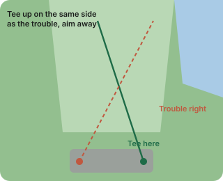

> [!key] Key points
> - **Tee up on the same side as the trouble** and aim away from it.
> - Aim at a **specific target**, not "the fairway".
> - Plan for your **typical miss** instead of hoping for a perfect shot.
> - When the fairway is tight, a **3-wood or hybrid** in play beats a driver in trouble.

## Use the whole tee box

The teeing area is several metres wide. If trouble is on the **right**, tee up on the **right** side and aim down the left half. That angles your shot away from the danger. Do the opposite when trouble is on the left.

## Aim small
"Hit the fairway" is too vague. Pick a specific target in the distance, like a tree, a bunker edge or a building, that sits on the line you want. Use the intermediate-target method from your [[pre-shot-routine]] to set up to it.

## Plan for your miss
Everyone has a shot pattern (see [[shot-dispersion]]). If your miss is a fade, aim down the **left side** and let it move towards the middle. If you aim at the centre, your normal fade finishes in the right rough, and your bad one finishes out of bounds.

| If you tend to… | Aim at… |
| --- | --- |
| Fade or slice | The left edge of the fairway (or left-centre) |
| Draw or hook | The right edge (or right-centre) |
| Hit it fairly straight | The middle, then shade away from the worst trouble |

## When to leave the driver in the bag
Ask: **what's the worst realistic outcome with each club?**
- Out of bounds or water in range of your driver's miss, but not your 3-wood's? Hit the 3-wood.
- The fairway narrows at driver distance? Lay back to where it's wider.
- A wide-open hole? Driver, every time. Extra distance is a big advantage.

> [!tip] The fairway-finder swing
> Have a "control drive" for tight holes: grip down an inch, make a three-quarter swing, and hold a balanced finish. You'll lose some distance but gain a lot of accuracy.

> [!mistake] Steering it
> Trying to *guide* the ball into a tight fairway usually makes you slow down and hold the face open, which is the classic recipe for a slice. Commit to your target and swing freely.

> [!drill] Fairway game
> On the range or simulator, define a 30-yard-wide fairway between two targets. Hit 14 drives, one for each driving hole, changing the "hole" each time with your full routine. Count how many finish in the fairway, and try to beat that number next session.
