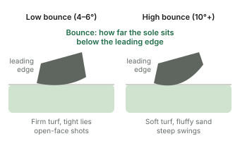

> [!key] Key points
> - Space your wedges about **4–6° of loft apart**, starting from your pitching wedge.
> - **Bounce** is the angle that keeps the sole from digging. More bounce suits **soft conditions and steep swings**.
> - **Low bounce** suits **firm turf, tight lies and shallow swings**.
> - Your **sand wedge** should usually have mid-to-high bounce for bunker play.

## Loft gapping
Check your pitching wedge's loft first. Many modern sets have a 43–45° PW, which leaves a big gap to a 56° sand wedge.

| Example setup | Lofts |
| --- | --- |
| Pitching wedge | 45° |
| Gap wedge | 50° |
| Sand wedge | 54–56° |
| Lob wedge (optional) | 58–60° |

Aim for **10–15 yards** between full shots with each wedge (see [[knowing-your-distances]]).

## Bounce explained

**Bounce** is the angle between the leading edge and the lowest point of the sole. More bounce means the sole sits lower and "bounces" off the turf or sand instead of digging in.

| Bounce | Suits |
| --- | --- |
| **Low (4–6°)** | Firm, dry turf; tight lies; sweeping swings; open-face shots |
| **Mid (7–10°)** | Most conditions; a good all-round choice |
| **High (10°+)** | Soft turf; fluffy sand; steep swings that take big divots |

## Grinds
A **grind** is how the sole is shaped (material removed from the heel, toe or trailing edge). Grinds let you open the face without the leading edge lifting too high. They're helpful if you play a lot of open-face shots, but they matter much less than loft and bounce for most golfers.

> [!tip] Match your course
> Firm, sandy courses (common around Perth in summer) often suit lower bounce on your gap and lob wedges, but still mid-to-high bounce on the sand wedge for soft bunkers. Consider the courses you play most.

> [!mistake] Using a low-bounce wedge in soft sand
> A low-bounce lob wedge in a soft bunker digs straight in. Use the wedge with the most bounce for greenside bunker shots (see [[greenside-bunker-shot]]).

> [!drill] Bounce feel
> In a practice bunker or on soft turf, make swings with a square face, then with the face open. Feel how the open face exposes more bounce and skims instead of digging. That's the feeling to use around the greens.
