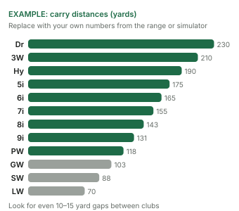

> [!key] Key points
> - You can carry **up to 14 clubs**. You don't have to carry 14.
> - **Loft** decides how high and how far each club goes.
> - Build the set around **even distance gaps** and the shots you actually play.
> - Most club golfers benefit from **more hybrids and wedges** and fewer long irons.

## The families

| Club | Typical loft | Main job |
| --- | --- | --- |
| **Driver** | 9–12° | Maximum distance from the tee |
| **Fairway woods** (3, 5, 7) | 15–21° | Long shots from the fairway; a safer option from the tee |
| **Hybrids** | 18–27° | Replace long irons; easy to launch, good from the rough |
| **Irons** (4–9) | About 20–40° | Approach shots; lower numbers go further and lower |
| **Pitching wedge** | 43–46° | Full approach shots and longer chips |
| **Gap wedge** | 48–52° | Filling the gap between the PW and SW |
| **Sand wedge** | 54–56° | Bunkers, pitches, chips |
| **Lob wedge** | 58–60° | High, soft shots around the green |
| **Putter** | 2–4° | Rolling the ball on the green |

Lofts vary a lot between brands. Modern "game-improvement" irons often have stronger (lower) lofts, so a 7-iron from one set can go as far as a 6-iron from another.

## A sample set for a club golfer
*Example only. Your set should match your own distances.*
- Driver, 3-wood, 5-wood
- Two hybrids (around 22° and 25°)
- 6-iron to pitching wedge
- Gap wedge, sand wedge
- Putter

That's 13. Some golfers add a lob wedge or a 7-wood instead.

## Building your set
1. **Start from the green and work back.** Wedges and putter get used most; make sure they suit you.
2. **Check your gaps** (see [[knowing-your-distances]]). Each club should do a different job.
3. **Drop clubs you don't trust.** If you never hit your 4-iron well, swap it for a hybrid (see [[long-irons-and-hybrids]]).
4. **Think about your course.** Lots of long par 4s favour hybrids and woods; a tight course might call for a driving iron or extra wedges.

> [!mistake] Carrying clubs that cover the same distance
> If your 5-wood and 3-hybrid both go 185 yards, one is wasted. Use the slot for a club that fills a gap.

> [!tip] Beginners
> You don't need 14 clubs. A half set (driver or 3-wood, hybrid, 6-, 8-iron, PW, SW and putter) is plenty to learn with, and decisions are simpler.

> [!drill] Club audit
> List every club in your bag with its average carry (see [[knowing-your-distances]]) and how often you used it in your last three rounds. Clubs with tiny gaps or no use are candidates to replace.
