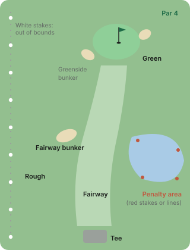

> [!key] Key points
> - A round is **18 holes** (sometimes 9). The aim is to get the ball in each hole in as few strokes as possible.
> - Every hole has a **par**: the number of strokes a good player is expected to take. Holes are par 3, 4 or 5.
> - The course is made up of **tees, fairways, rough, bunkers, penalty areas and greens**.
> - Coloured stakes tell you what's what: **white = out of bounds, red and yellow = penalty areas**.

## What a hole looks like

| Part | What it is |
| --- | --- |
| **Tee** (teeing area) | Where each hole starts. Tee the ball up between the markers, and no more than two club-lengths behind them |
| **Fairway** | The short-mown strip leading to the green. The best place to play from |
| **Rough** | Longer grass either side of the fairway. Harder to control the ball from |
| **Bunkers** | Hollows filled with sand. Special rules apply (see [[essential-rules]]) |
| **Penalty areas** | Water, creeks, and sometimes bush, marked with red or yellow stakes or lines |
| **Out of bounds** | Outside the course, marked with white stakes or a boundary fence |
| **Green** (putting green) | The very short grass around the hole, where you putt |

## Par

| Par | Typical length (men's tees) | The plan |
| --- | --- | --- |
| Par 3 | Up to about 250 yards | Tee shot onto the green, then two putts |
| Par 4 | About 250–470 yards | Drive, approach onto the green, two putts |
| Par 5 | About 470+ yards | Three shots to reach the green, two putts |

Most 18-hole courses add up to a **par of 70–72**. Scores relative to par have names:

| Score on a hole | Name |
| --- | --- |
| 2 under par | Eagle |
| 1 under | Birdie |
| Par | Par |
| 1 over | Bogey |
| 2 over | Double bogey |

> [!tip] Being realistic
> Par assumes very good golf. For most club golfers, bogey is a solid score on a hard hole. Set your own "par" for each hole based on your handicap (see [[scoring-and-handicaps]]).

## How a round plays out

1. **On the tee**, players hit in turn. On the first tee, order is usually decided by a coin toss or the draw. After that, the lowest score on the previous hole goes first ("the honour"). In casual golf most groups play **ready golf**: whoever is ready hits first, as long as it's safe.
2. **After the tee shot**, the player furthest from the hole normally plays next.
3. Each player keeps playing **their own ball** until it's in the hole. You can't swap balls mid-hole.
4. On the green, mark your ball, putt out, and **write scores down at the next tee**, not on the green, so the group behind isn't kept waiting.

## The clubs

You can carry up to **14 clubs**. In simple terms:
- **Driver and woods**: the longest shots, mostly off the tee.
- **Hybrids and irons**: shots from the fairway to the green. Lower numbers go further.
- **Wedges**: short approach shots, chips and bunker shots.
- **Putter**: rolling the ball on the green.

See [[whats-in-the-bag]] for what each club is for.

> [!drill] Your first time out
> Start on a short or par-3 course, or play 9 holes at a quiet time. Pick up your ball once you reach double par on a hole. It keeps the pace up and the round fun.
