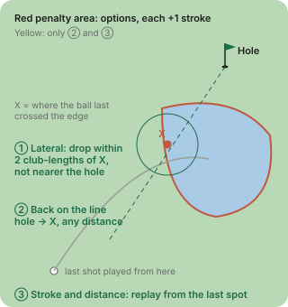

> [!key] Key points
> - **Out of bounds or lost:** 1 stroke, and replay from where you last hit (stroke and distance).
> - **Penalty area (red or yellow):** 1 stroke, with several drop options. Red gives you one more option than yellow.
> - **Unplayable:** 1 stroke, with three options. You decide when your ball is unplayable.
> - **Free relief** for cart paths, sprinklers, ground under repair, temporary water and animal holes.

## How to drop
- Drop from **knee height**, straight down.
- The ball must land in, and stay in, the **relief area** you're allowed.
- A **club-length** means your longest club other than the putter (usually the driver).
- If it rolls out of the relief area, drop again. If that also rolls out, place it where it first landed on the second drop.

## Out of bounds and lost balls
**Penalty: 1 stroke.** Play again from where you hit the last shot (**stroke and distance**). From the tee, you're now hitting your third shot.

> [!note] The local-rule alternative
> Many clubs use a local rule (Model Local Rule E-5) for casual and general play. Instead of going back, you can drop near where the ball went out or was lost, on the fairway side, for **2 penalty strokes**. Check your scorecard. It isn't used in higher-level competitions.

## Penalty areas (water)

You can **play the ball as it lies** in a penalty area with no penalty. You can even ground your club. If it's not playable, take relief for **1 stroke**:

| Option | Yellow | Red |
| --- | --- | --- |
| ① **Lateral:** drop within 2 club-lengths of where it last crossed the edge, not nearer the hole | ✗ | ✓ |
| ② **Back on the line:** keep the point where it crossed between you and the hole, and go back as far as you like | ✓ | ✓ |
| ③ **Stroke and distance:** replay from your last spot | ✓ | ✓ |

The key is knowing **where the ball last crossed the edge** of the penalty area, not where it finished.

## Unplayable lie
You can declare your ball unplayable **anywhere except a penalty area**. **Penalty: 1 stroke**, then choose:
1. **Stroke and distance:** replay from the last spot.
2. **Back on the line:** keep the ball's spot between you and the hole, and go back as far as you like.
3. **Lateral:** drop within 2 club-lengths, not nearer the hole.

**In a bunker:** options 2 and 3 must stay in the bunker. For **2 strokes** total, you can also go back on the line *outside* the bunker.

## Free relief (no penalty)

| Condition | Examples |
| --- | --- |
| **Immovable obstructions** | Cart paths, sprinkler heads, drink fountains |
| **Abnormal course conditions** | Ground under repair (often white lines or blue stakes), temporary water, animal holes |
| **Embedded ball** | Plugged in its own pitch mark in the fairway or rough (not in sand) |
| **Wrong green** | Your ball is on a different hole's green. You *must* take relief |

**How:** find the **nearest point of complete relief**, the nearest spot not nearer the hole where the condition no longer affects your ball, stance or swing. Then drop within **one club-length** of it, not nearer the hole.

> [!mistake] Taking the "nicer" drop
> The nearest point of relief isn't always the side you'd like. On a cart path it might be the rough side. You can't pick the fairway side just because it's better.

> [!tip] Penalty strokes are a strategy choice
> The cheapest option isn't always the obvious one. From a terrible lie, a 1-stroke unplayable to a good spot often beats hacking at it twice. See [[recovery-shots]].
