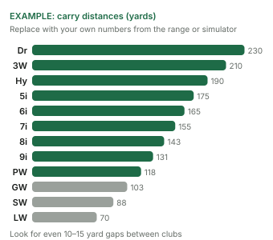

> [!key] Key points
> - Most missed greens are **long or short**, not left or right, and amateurs miss **short** far more often.
> - Plan for **carry** distance to the target, then allow for roll.
> - Use your **average** carry for each club, not your best.
> - Learn a reliable **three-quarter swing** for in-between yardages.

## Why distance matters most
A green is usually wider than it is deep. Shot-tracking data from amateur golfers consistently shows that **coming up short** is the most common approach miss. Golfers pick the club for their best strike, not their typical one.

## Step 1: Know your carry numbers
You need to know how far each club **carries** in the air on a solid, normal swing. Get them from a launch monitor, a simulator, or by hitting to measured targets. See [[knowing-your-distances]].

## Step 2: Work out the real number
Start with the distance to the flag (or to where you want to land), then adjust:

| Factor | Typical adjustment |
| --- | --- |
| Pin at the front/back | Measure to the *front* edge and add the right amount |
| Uphill / downhill | Plays longer uphill, shorter downhill |
| Wind | Into the wind plays longer; downwind shorter (see [[playing-in-wind]]) |
| Lie | From the rough, the ball may fly further and roll more (see [[playing-from-the-rough]]) |
| Firm or soft greens | Firm: land it shorter. Soft: fly it closer to the hole |

The full method is in [[wind-elevation-temperature]].

## Step 3: Pick the club, commit to the swing
- If the number sits **between clubs**, see [[between-clubs]]. Usually take the longer club and swing smoothly.
- Choose a **target inside the green**, not just "the flag" (see [[choosing-approach-targets]]).

## In-between distances
Three simple ways to take 5–10 yards off a club without changing your swing:
1. **Grip down** about 2–3 cm. You'll lose a few yards and gain control.
2. **Three-quarter swing**: hands to about shoulder height, with a matching finish.
3. **Narrower stance**: naturally shortens the swing.

> [!mistake] Hitting harder to go further
> Swinging harder to make a short club reach usually means a poor strike, more spin and less distance. Take more club and swing at your normal tempo.

> [!drill] Carry ladder
> Pick three targets at different distances. Hit one ball to each with a different club, returning to the first after the third. Note how many finish pin-high (level with the target) or past it. Do the same on a simulator using the carry readout.

> [!tip] Long is often fine
> Unless there's trouble behind the green, a ball that finishes 5 metres long usually leaves an easier chip than one that's short in a bunker. When in doubt, take more club.
