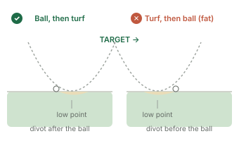

> [!key] Key points
> - Good iron shots hit the **ball first, then the turf**. The divot starts **after** the ball.
> - That only happens when the **low point** of your swing is **in front of the ball**.
> - Three things control it: **ball position**, **pressure moving to your lead side**, and **hands ahead** at impact.
> - Don't try to lift the ball. **The loft does that.**

## What it looks like



The bottom of your swing arc, the **low point**, should be roughly 5–10 cm in front of the ball with irons. The club is still travelling down when it meets the ball, which squeezes it against the face. That's "compression": a solid feel, a penetrating flight and consistent distance.

```figure
type: compare
good: impact
bad: impact-flip
good-label: Hands ahead, weight forward
bad-label: Flipping, weight back
pressure: true
```

## The three controls

**1. Ball position.** Too far forward and the low point arrives before the ball. Keep short irons in the centre and mid-irons a ball forward (see [[ball-position]]).

**2. Pressure into the lead side.** In the downswing, your pressure should move firmly onto your lead foot before impact. If you hang back on your trail side, the low point moves behind the ball. See [[weight-transfer]].

**3. Hands ahead.** At impact your hands should be over your lead thigh, slightly ahead of the ball, with the shaft leaning towards the target. If the clubhead overtakes the hands ("flipping"), the low point shifts back and you add loft.

> [!mistake] Helping the ball up
> The urge to scoop the ball into the air is the cause of most fat and thin iron shots. Trust the loft. Hitting down makes the ball go up.

> [!drill] Line drill
> Draw a line on the ground (or lay a line of tees). Put balls right on it. Hit shots aiming for the divot to start **on the target side** of the line. Count how many of ten do. On a simulator mat, use a strip of tape and watch for marks on the club's sole.

> [!drill] Towel drill
> Lay a towel 10–15 cm behind the ball. Hit the ball without touching the towel. If you hit it, your low point is too far back.

> [!tip] Divots tell the story
> Look at every divot. One that starts behind the ball means low point too far back. One pointing left of target means an out-to-in path. A shallow, bacon-strip divot after the ball pointing at the target is perfect.
