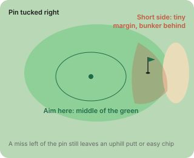

> [!key] Key points
> - Your shots spread out. Aim so that **most of that spread finishes on the green**.
> - **Green light** pins: go at them. **Red light** pins: aim at the middle.
> - Avoid **short-siding** yourself (missing on the side the pin is on).
> - **Uphill putts** are easier than downhill ones, so consider which side of the hole to leave it.

## Why the middle works

Even good amateurs spread their iron shots over a wide area. From 150 yards, a typical club golfer's shots might spread over 30–40 yards left to right, and similar front to back. Aim at a pin tucked behind a bunker and half of that spread finds trouble. Aim at the middle and almost all of it finds the green or a simple chip.

## Traffic-light system

| Pin | When | Aim at |
| --- | --- | --- |
| 🟢 **Green light** | Pin in the middle; short iron or wedge; no trouble around it | The flag |
| 🟡 **Yellow light** | Pin slightly to one side; mid-iron | Between the flag and the middle |
| 🔴 **Red light** | Pin tucked near a bunker, water or edge; long iron or hybrid | The middle of the green, or the safe side |

Your handicap changes the colours. A 25-handicapper sees more red lights than a 5-handicapper.

## Short side vs fat side
- **Short side:** the side of the green the pin is close to. A miss there leaves very little green to work with, which means hard chips over bunkers.
- **Fat side:** the side with lots of green between the edge and the hole. Misses there leave an easy chip or long putt.

**Always favour the fat side.** If the pin is on the right, miss left.

## Think about the next putt
Greens slope, usually from back to front. A ball **below the hole** leaves an uphill putt that you can hit firmly. A ball above it leaves a fast, tricky downhill putt. On a sloping green, being 6 metres below the hole is often better than 3 metres above.

> [!mistake] Flag-hunting
> Firing at every pin feels aggressive and fun, but for most golfers it adds shots. Each time you short-side yourself into a bunker, it's likely a bogey or worse. Middle-of-the-green golf piles up pars.

> [!drill] Middle-of-the-green round
> Next round, aim every approach at the centre of the green except green-light pins. Count your greens in regulation (on in par minus two shots) and compare with your usual. Most golfers hit more greens *and* make more birdies.
