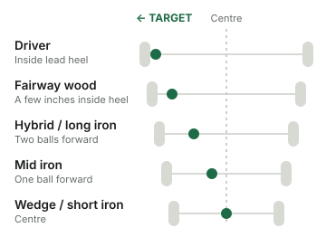

> [!key] Key points
> - Ball a few inches **inside your lead heel**.
> - Make a **sweeping** strike, with the bottom of the swing at the ball. Not down like an iron, not up like a driver.
> - From the fairway, a **5- or 7-wood** is much easier than a 3-wood for most golfers.
> - Use them off the tee when **accuracy matters more than distance**.

## Off the fairway
1. **Ball position:** a few inches inside the lead heel, a little behind where you'd tee a driver.
2. **Stance:** shoulder-width, weight balanced.
3. **Spine:** a slight tilt away from the target (less than the driver).
4. **Strike:** sweep the ball off the turf. You should brush the grass, not take a divot.
5. **Finish:** full and balanced. Let the loft do the work.

> [!mistake] Trying to help it up
> The fairway wood has the least loft you'll hit off the ground. If you lean back to scoop it, you'll top it. Stay centred over the ball and turn through to the finish.

## Which fairway woods to carry

| Club | Loft (approx.) | Off the deck |
| --- | --- | --- |
| 3-wood | 15° | Hard, needs good speed and a good lie |
| 5-wood | 18° | Much easier; launches higher and lands softer |
| 7-wood | 21° | Very easy to launch; a great hybrid alternative |

If you struggle to get your 3-wood airborne from the fairway, keep it for the tee and add a 5-wood.

## Off the tee
A fairway wood is a great **"fairway finder"**:
- Tee it **low**, just an inch or so off the ground.
- Same sweeping swing.
- Use it when the driver's miss brings trouble into play (see [[finding-fairways]]).

## When to go for it with a wood
Before reaching for a fairway wood on a par 5, ask:
- **Is the lie good?** From rough or a poor lie, a hybrid or mid-iron is safer.
- **What's the miss?** If water or out of bounds guards the green, lay up instead (see [[risk-and-reward]]).
- **Does it get me much closer?** A 200-yard wood that leaves 40 yards isn't always better than two easy shots.

> [!drill] Brush the grass
> Make practice swings without a ball, trying to brush the same spot of grass every time, with no divot and no missing the ground. Then put a ball on that spot. Do this ten times before hitting fairway woods on the range.
