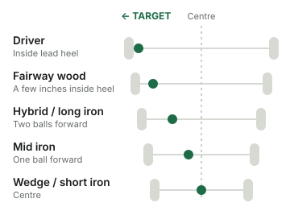

> [!key] Key points
> - Long irons are hard because they have **little loft** and a **small, thin head**.
> - **Hybrids** launch higher, are more forgiving and come out of rough more easily. Most club golfers should use them instead of 3–5 irons.
> - Play both slightly **forward of centre** with a **shallow** strike.
> - **Don't try to lift** the ball. Low lofts reward a smooth, balanced swing.

## Why long irons are tough
A 4-iron has much less loft than a 7-iron, and its centre of gravity sits close to the face. To launch it high enough to land softly, you need real speed and a precise strike. Below tour-level speed, many golfers hit their 4-iron about the same distance as their 5-iron, just lower and less consistently.

## Why hybrids help
A hybrid has a wider sole and a centre of gravity set **lower and further back**. That:
- Launches the ball **higher** with the same loft
- Is more **forgiving** on off-centre strikes
- **Glides** through rough instead of getting tangled

| Replace | With a hybrid of about |
| --- | --- |
| 3-iron | 19–20° |
| 4-iron | 21–23° |
| 5-iron | 24–26° |

Check your gapping (see [[knowing-your-distances]]). The hybrid should fill the gap between your longest iron and your fairway wood.

## How to hit them
1. **Ball position:** about two balls forward of centre (see [[ball-position]]).
2. **Setup:** like a mid-iron. Weight balanced, hands level with or just ahead of the ball.
3. **Strike:** a shallow, sweeping-down blow. You'll take a small divot or brush the grass, nothing deep.
4. **Tempo:** smooth. These clubs are long; rushing them throws off the strike.

> [!mistake] Hitting up on it
> Seeing the low loft, many golfers hang back and try to lift it, which gives a thin or topped shot. Stay centred and let your pressure move into the lead side, as with any iron.

> [!tip] Hybrids around the green
> From the fringe or a tight lie, a hybrid can be chipped with a putting stroke. It pops the ball over the fringe and rolls it like a putt. It's a good option when the grass is too thick to putt through.

> [!drill] Tee it low
> Practise with the ball on a very low tee, just above the grass, to build confidence and a sweeping motion. Then hit the same shot off the grass.
