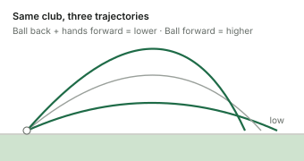

> [!key] Key points
> - **In a divot:** ball back, hands forward, a steeper strike. Expect it lower and running.
> - **Hardpan and bare lies:** pick it clean. Avoid wedges with lots of **bounce**, because the sole will skip off the ground.
> - Around the green, **putt or use a low-lofted club** whenever you can.
> - Accept a **slightly less ambitious** target.

## Ball in a divot
Unlucky, but very playable:
1. **Ball back** an inch or two from normal.
2. **Hands forward** and weight on your lead side, like a punch shot (see [[trajectory-control]]).
3. A **steeper** swing: hinge your wrists a little earlier and hit **down** firmly so the club gets to the bottom of the ball.
4. A **shorter finish** is fine. The club may dig into the far side of the divot.

**Expect:** a lower flight with less spin. The ball will run further. Allow for it, and if there's trouble just over the green, take a shorter club.

**Sand-filled divot:** treat it like a fairway bunker shot. Ball first, no fat.

## Hardpan (hard, bare, compacted ground)
The danger is the club **bouncing** off the ground into the middle of the ball.
- Use a club with **low bounce**: a pitching wedge or 9-iron rather than a sand wedge.
- **Ball centre or slightly back**, hands ahead.
- **Pick it clean**, with a shallow, controlled strike. Thin is much better than fat.
- Avoid big, open-faced shots.

## Bare lies around the green
- **Putt it** if the ground between you and the green is smooth.
- Otherwise, **chip with a 7- to 9-iron** using a putting stroke, which keeps the leading edge low and limits bounce.
- Avoid the flop shot. It's very risky from a bare lie (see [[flop-and-specialty-shots]]).

> [!mistake] Trying to lift it out
> From a divot or bare ground, the instinct is to scoop. That's exactly what causes thin and fat shots. Hit down; let the loft work.

> [!note] Rules
> A ball in a divot gets no free relief. Play it as it lies. If it's in **ground under repair** (marked area), you get free relief (see [[penalties-and-relief]]). Many clubs allow placing in fairway divots in casual play, but that's a local agreement, not a rule.

> [!drill] Tough lies session
> On the practice ground, find a few old divots and a bare patch. Hit five shots from each, noting the flight and how far they run compared with a normal lie. You'll go into those situations on the course with a plan.
