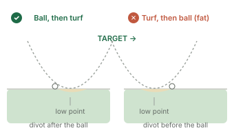

> [!key] Key points
> - **Check the lip first.** Choose a club with enough loft to clear it.
> - **Ball first, no sand.** The opposite of a greenside bunker shot.
> - **Quiet lower body** and a balanced, three-quarter swing.
> - **Thin is better than fat.** A slightly thin shot still goes forward; a fat one stays in the bunker.

## Step 1: Assess
- **The lip:** how high is it, and how close? From a deep bunker, take enough loft to clear it, even if you can't reach the green.
- **The lie:** sitting cleanly on the sand, or sunk in? A poor lie means a lofted club and just getting out.
- **The distance:** what do you need, and what's realistic?

## Step 2: Set up
1. **Grip down** about 2–3 cm. You'll dig your feet in slightly, which lowers you.
2. **Wiggle your feet** in just enough for stability, less than for a greenside shot.
3. **Ball in the centre**, or a fraction back, to make ball-first contact easy.
4. **Weight centred** or slightly forward. Keep it there.
5. **Hover the club** above the sand. Touching the sand before your stroke is a penalty (see [[essential-rules]]).
6. **Take one more club** than from the fairway, since you're gripping down and swinging at 75–80%.

## Step 3: Swing
- **Three-quarter swing**, with your lower body quiet. Too much leg action and your feet slip.
- **Focus on the front of the ball.** Picking it clean is the goal.
- **Stay level.** Don't dip down into the sand.

> [!mistake] Using the greenside technique
> Opening the face and hitting behind the ball works next to the green, but from a fairway bunker it loses all your distance. Hit the ball first.

> [!tip] Hybrids and fairway woods
> From a good lie with a low lip, a hybrid or 7-wood can be a great option. Its wide sole helps it skim the sand rather than dig. Avoid long irons; they're unforgiving if you catch the sand.

> [!drill] Line in the sand
> In a practice bunker, draw a line and place the ball just in front of it (on the target side). Hit shots without touching the line. It trains the clean, ball-first contact you need.
