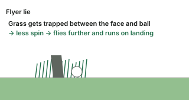

> [!key] Key points
> - **Read the lie first:** is the ball sitting up, or down in the grass?
> - **Light rough** can produce a **flyer**: less spin, more distance and more roll.
> - **Heavy rough** grabs the club and closes the face. Use **more loft**, a **steeper** swing, and aim to just get out.
> - **Hybrids** cut through rough better than long irons.

## Read the lie

| Lie | What happens | Plan |
| --- | --- | --- |
| **Sitting up** on top of the grass | Easy to go under it | Grip down a little; sweep it like a fairway wood; hover the club |
| **Light rough**, ball half visible | Often a **flyer** | Take less club, or play to land short and run |
| **Sitting down**, ball deep in grass | Grass grabs the hosel, the face closes, the ball comes out low and left with little distance | More loft, steeper swing; aim for the fairway |
| **Into the grain** (grass growing towards you) | Extra resistance | Even more loft; firm grip |

## The flyer

When grass gets trapped between the clubface and the ball, the grooves can't grip the ball. That means **less backspin**, so the ball:
- Flies **further** than normal (sometimes a club or more)
- Comes in **lower** and **runs** after landing
- Won't stop on the green

**Plan:** take less club, or aim to land the ball short of the green and let it run on.

## Heavy rough technique
1. **Choose loft.** A 9-iron or wedge gets out far more reliably than a long iron.
2. **Ball slightly back** of centre.
3. **Firmer grip**, especially the lead hand, so the grass doesn't twist the face.
4. **Steeper swing:** hinge the wrists earlier and hit down on the ball so there's less grass between the club and the ball.
5. **Aim right a little:** the grass tends to close the face, sending the ball left.
6. **Target the fairway.** Getting back in play is the win.

> [!mistake] Long irons from thick rough
> The grass wraps around the club and stops it dead. The ball goes 30 metres. A wedge back to the fairway, followed by a full shot, is nearly always better.

> [!tip] Hybrids from light rough
> A hybrid's rounded sole glides through light rough far better than an iron. It's often the best choice for long shots from the semi-rough.

> [!drill] Rough session
> Drop balls in different rough lies near the practice green. For each one, predict what will happen, then hit it. Compare. Learning to read lies is a skill. Practise it.
