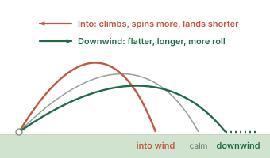

> [!key] Key points
> - **Into the wind:** take more club and **swing smoother**. "When it's breezy, swing easy."
> - **Downwind:** less club; the ball flies lower and runs more, and it's hard to stop on greens.
> - **Crosswind:** aim into it and let the wind bring it back.
> - **Keep the ball lower** to reduce the wind's effect.

## Into the wind
A headwind adds lift and spin, so the ball **climbs**, stalls and falls short. Any sidespin is exaggerated too.
- Take **one to three more clubs**, depending on strength.
- **Swing at 75–80%** with the longer club. Hitting harder adds spin, which makes the ball balloon even more.
- **Play it lower:** ball back slightly and a shorter finish (see [[trajectory-control]]).
- **Tee it lower** with the driver.

## Downwind
A tailwind reduces lift and spin. The ball flies **lower and further**, then **runs**.
- Take **less club**, typically half to one club.
- Expect the ball to **run on landing**. Land it shorter.
- Hitting a high shot downwind with the driver uses the wind for extra carry.
- Short shots are hard to stop. Allow for release.

## Crosswind
Two options:
- **Aim off and let it drift** (easiest): aim into the wind and let it bring the ball back. The higher and longer the shot, the more it drifts.
- **Hold it against the wind** (advanced): curve the ball into the wind so it flies straight. For example, a draw into a left-to-right wind.

As a guide: **downwind plus a curve the same way** means a lot of curve. **Into the wind plus curve** means even more. Leave yourself room.

## Putting and chipping in wind
- **Widen your stance** for stability.
- Strong wind affects **long putts** on fast greens. Allow for a little drift.
- Chip **lower**. A bump-and-run is less affected than a lob.

> [!mistake] Swinging harder into the wind
> It feels natural, but extra speed means extra spin, and the ball balloons and comes down short. One more club, smoother swing.

> [!tip] Check the treetops
> The wind at ball height and up in the air can differ. Look at the tops of trees and the flag on the green, not just the grass at your feet.

> [!drill] Windy-day practice
> Don't skip practice on windy days. Hit the same club into, down and across the wind, and note the differences in carry and curve. You'll learn more about your ball flight than on a calm day.
