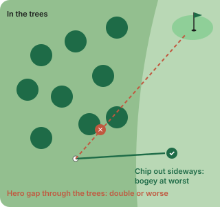

> [!key] Key points
> - **First priority: get back in play.** Second: advance the ball if it's safe.
> - Choose the **biggest gap**, not the most direct one.
> - A **sideways chip-out** usually costs one shot; a failed hero shot often costs three.
> - Sometimes an **unplayable** (1 penalty stroke) is the cheapest option.

## Take your medicine
When you're in trees, deep rough or behind an obstacle, picture ten attempts at the heroic shot. How many come off? What happens to the rest? Usually:
- **Chip out sideways:** you'll make bogey (sometimes par) almost every time.
- **Through the small gap at the green:** occasionally brilliant, often hits a tree and stays in the woods. Double or worse.

## The punch shot under branches
1. Take a **less-lofted club** (5- to 7-iron) so the ball stays low.
2. **Ball back** in your stance, hands well ahead.
3. **Short, firm** backswing and a **low, abbreviated** finish (see [[trajectory-control]]).
4. Pick a target that gives the ball **plenty of room** to run out.

## Over the top
If there's a wall of trees and an open sky, a high shot with a lofted club can work. Check the ball can climb steeply enough: lay the club on the ground with the face pointing up, and stand on the face. The angle of the shaft shows roughly the launch.

## When to take a penalty
- Ball against a tree, in a bush, or no backswing possible? Declaring an **unplayable lie** (1 stroke) and dropping into a playable spot can save you strokes (see [[penalties-and-relief]]).
- The penalty drop often leaves a **full shot**, rather than a hacked chip-out followed by another shot.

> [!mistake] Two trees in a row
> The most common recovery disaster is going for a small gap, hitting a tree, and then going for another small gap from a worse spot. After the first miss, chip out to the widest opening.

> [!tip] Look backwards too
> Sometimes the best way out is **back** towards where you came from, or to a different hole's fairway, if it's in bounds and safe. It's not pretty, but it keeps the big number off the card.

> [!drill] Trouble-shot practice
> Next time you practise, set up an imaginary tree with an umbrella or bag. Hit punch shots under it and over it. A few minutes of this makes the real thing far less stressful.
