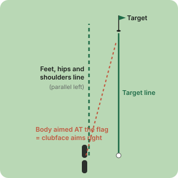

> [!key] Key points
> - **Block practice** (same club, same target) builds technique, but it feels better than it really is.
> - **Random practice** (change club and target each ball) builds the skill you use on the course.
> - **Always have a target**, and use alignment sticks.
> - Finish with **game-like practice**: play holes in your head with your full routine.

## Block vs random

| | Block practice | Random practice |
| --- | --- | --- |
| What | Lots of balls, same club, same target | Change club, target or shot each ball |
| Feels | Great: you get into a rhythm | Harder: more misses |
| Good for | Learning a new movement | Performing on the course |

Motor-learning research consistently finds that **random practice** leads to better results on the course, even though block practice *feels* more productive at the time. Use block practice briefly for technique, then switch to random.

## A 50-ball session
*Example structure.*
1. **10 balls warm-up:** wedges, then mid-irons, easy tempo.
2. **15 balls technique (block):** one focus, such as takeaway or ball position, with alignment sticks down.
3. **20 balls random:** change club and target every ball, with a full routine.
4. **5 balls "first tee":** one shot with the club you'll use on the 1st, then rest, then repeat.

## Play the course on the range
Pick your home course and "play" it: driver for the first tee shot (choose a "fairway" between two markers), then the approach club you'd normally need, then the next hole. Score yourself: in the fairway or not, green or not. It's the closest thing to the real course you can do on a range.

> [!mistake] No target
> Hitting balls "out there" without a specific target means you can't tell a good shot from a bad one. Pick a flag, a sign or a patch of grass every time.

> [!tip] Alignment sticks every session
> Lay one stick on the target line and one on your toe line (see [[alignment]]). Without them, it's easy to spend a whole session aiming right and "fixing" a slice that's really an aim problem.

> [!drill] Nine-shot challenge
> Try to hit, in any order: a low draw, a low straight shot, a low fade, then the same at medium height, then high. You probably won't manage all nine, but trying teaches clubface control better than anything (see [[draws-and-fades]]).
