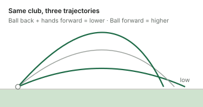

> [!key] Key points
> - **Ball position** and **hands** set the trajectory.
> - **Lower:** ball back, hands forward, shorter finish.
> - **Higher:** ball forward, hands level, full high finish.
> - Change the **setup**, not the swing speed.

## Why control trajectory?
- **Into the wind:** a lower flight is less affected.
- **Under trees:** keep it low to escape (see [[recovery-shots]]).
- **Over trees, or to stop the ball on a firm green:** go higher.
- **Firm, fast conditions:** a lower shot that runs can be more reliable.

## The low shot (punch or knock-down)
1. Take **one or two more clubs** than normal, since a lower shot flies shorter.
2. **Ball back** an inch or two from normal.
3. **Hands ahead** of the ball, with more forward shaft lean.
4. **Weight forward:** about 60% on the lead side, staying there.
5. Make a **three-quarter** backswing and a **short, low finish**, with the hands finishing around chest height.

## The high shot
1. **Ball forward** an inch or so.
2. **Hands level** with the ball, less shaft lean.
3. Let your **spine tilt** away from the target a touch more.
4. Make a **full swing** to a **high finish**.
5. Choose a club with **enough loft**. You can only add a little height with technique.

> [!mistake] Scooping to hit it high
> Hanging back and flicking at the ball adds height but ruins contact. Get height from setup and loft, with a normal ball-first strike.

> [!tour] On tour
> Tour players in windy conditions often hit "three-quarter" shots with one or two extra clubs to keep the ball flight down and the spin lower. It's the same knock-down described above.

> [!drill] Three heights
> With a 7-iron, hit five low, five normal and five high shots. On a simulator, watch the **launch angle** and **peak height** readouts. Aim for clear differences between the three. Do it with other clubs once the 7-iron feels comfortable.
