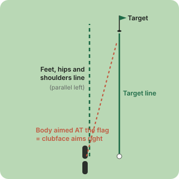

> [!key] Key points
> - **Clubface first, body second.** Aim the face at the target, then set up around it.
> - Your feet, hips and shoulders should be **parallel left** of the target line, not pointing at the target.
> - Use an **intermediate target** a foot or two in front of the ball.
> - Practise with **alignment sticks** every session.

## The railway tracks

Picture a set of railway tracks. The **outer rail** runs from your ball to the target. The **inner rail**, the one you stand on, runs parallel to it.

That means your body should aim slightly **left** of the target, not at it. If you line your feet and shoulders up *at* the flag, the clubface ends up aiming right of it. This is the most common aiming mistake in golf.

## Setting up, step by step

1. **Stand behind the ball** and look down the line at your target.
2. **Pick an intermediate target**: a divot, a leaf or a darker patch of grass, about a foot or two in front of the ball and on the line to the target. It's much easier to aim at something close.
3. **Walk in and set the clubface** square to that spot, with your right hand on the club.
4. **Set your feet** parallel to the line between the ball and your spot.
5. **Check hips and shoulders.** The shoulders matter most, because they have the biggest influence on swing path.

> [!mistake] Open shoulders
> Many golfers have their feet square but their shoulders aimed left. That often comes from the ball being too far forward, or the right hand reaching too far over. Open shoulders send the swing across the ball from out to in, which is the classic slice path. See [[fixing-a-slice]].

## Why you can't trust your eyes

When you stand beside the ball, you're looking at the target from an angle, side-on to the line. Your brain is bad at judging straight lines from there, so being "aimed right" often *looks* correct. That's why the routine starts from **behind** the ball, and why alignment sticks are so useful in practice.

> [!drill] Two-stick setup
> Lay one alignment stick just outside the ball, pointing at your target. Lay a second stick parallel to it along your toes. Hit balls with both sticks down until standing parallel feels normal. Then take the toe-line stick away and check yourself every few balls.
>
> On a simulator, check the on-screen target line too. Many sims let you see where your setup is aimed.

> [!tip] Check your shoulders
> Once you're set up, hold a club across the front of your shoulders. Then look along the shaft without moving your body. It should point parallel left of the target, not at it.

Alignment is the core of a good [[pre-shot-routine]]. Build it into every shot.
