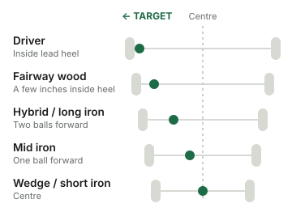

> [!key] Key points
> - Short irons and wedges: **centre** of your stance.
> - Each longer club moves the ball **a little further forward**.
> - Driver: in line with the **inside of your lead heel**.
> - Wrong ball position causes thin, fat and crooked shots even when the swing is good.

## Why it matters

Your swing is a circle, and the ball needs to sit at the right point on it.

With **irons**, the bottom of the swing should be just *in front of* the ball. That way you hit the ball first, then the turf, and compress it with a descending blow. With the **driver**, the ball is teed up and you want to catch it slightly *on the way up*, which launches it higher with less spin for more distance.

Ball position is how you match each club to the right part of the arc.

## Club-by-club guide

| Club | Ball position | Why |
| --- | --- | --- |
| Wedges and 9-iron | Centre of stance | Steeper strike; ball first, then turf |
| 8 to 6-iron | About one ball forward of centre | Still descending, slightly shallower |
| 5-iron, 4-iron and hybrids | Two balls forward of centre | Shallower strike, more launch |
| Fairway woods | A few inches inside the lead heel | Sweeping strike, with the bottom of the arc at the ball |
| Driver | In line with the inside of the lead heel | Upward strike, high launch and low spin |

Your stance also gets **narrower** with shorter clubs. Wedges need roughly hip-width feet, and the driver about shoulder-width or a touch wider. Because the stance changes too, the ball looks like it moves further than it actually does relative to your lead foot.

> [!tour] Another approach
> Ben Hogan famously kept the ball about the same distance from his lead heel for every club. He changed only the position of his trail foot, widening the stance as the clubs got longer. Some golfers find one fixed reference point easier to repeat. Try both and stick with whichever gives you more consistent contact.

## When ball position is off

**Too far back:**
- The ball comes out low and often starts right of target, because you catch it before the face has squared up.
- Steep, deep divots and a "trapped" feel.
- With the driver: low, spinny shots that slice.

**Too far forward:**
- Fat shots (turf first) or thin shots as you reach for it.
- Pulls left as your shoulders open up to get to the ball.
- High, weak shots that come up short.

> [!mistake] Ball position creep
> Over a few weeks, the ball tends to drift forward in your stance without you noticing, especially after a lot of driver practice. If contact suddenly gets worse for no obvious reason, check ball position first.

> [!drill] Alignment stick check
> Lay one alignment stick along your toe line, pointing at the target. Lay a second one at right angles to it, pointing at the ball. Now you can see exactly where the ball sits relative to your feet. Take a photo from face-on with your phone and check it against the table above. This also works well on a simulator mat.

## On slopes

Ball position also changes on uneven ground. On an [[uphill-lie|uphill lie]] it moves slightly forward. On downhill lies it moves back. The slope lessons cover each one.
